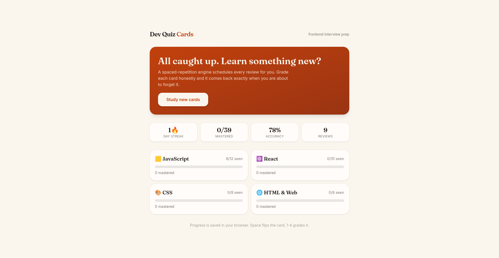

# Dev Quiz Cards

Frontend interview flashcards that schedule themselves. Instead of cramming, a spaced-repetition engine (SM-2 style) decides what you review today across four decks: JavaScript, React, CSS and HTML & Web.

**Live demo:** https://malakmo7amed309.github.io/dev-quiz-cards/

## Standout feature

A real spaced-repetition scheduler. Every card carries its own ease factor, interval and due date. Grade yourself Again / Hard / Good / Easy and the card is rescheduled exactly when you are about to forget it - "Again" cards come back within the same session. The home screen shows your due-today queue, per-deck mastery, review accuracy and a day streak, all persisted in localStorage.

## Stack

- React 19
- Tailwind CSS 4
- Vite (built to a single self-contained HTML file)
- No backend - progress lives in your browser

## How it works

1. Open the app - the home screen shows how many cards are due today.
2. Start a session: due cards plus up to 8 new cards are dealt.
3. Flip the card (tap or Space), answer out loud, then grade honestly (keys 1-4).
4. The scheduler stores each card's next review date. Mastered cards (21+ day intervals) fill the deck progress bars.

## Card decks

- **JavaScript** - closures, event loop, `this`, promises, equality, destructuring...
- **React** - hooks rules, useEffect, keys, controlled components, context, memoization...
- **CSS** - box model, flex vs grid, positioning, specificity, units, stacking contexts...
- **HTML & Web** - semantics, storage, CORS, HTTP verbs, accessibility, what happens when you type a URL...

## Run it locally

```bash
npm install
npm run dev
```

Build for production:

```bash
npm run build
```

The build emits one self-contained `dist/index.html` (all JS and CSS inlined), which is what GitHub Pages serves from the `docs/` folder of this repo.

## Screenshot


